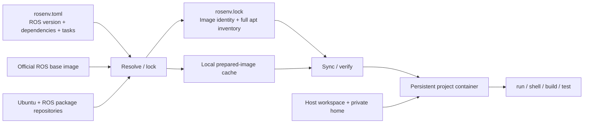

# Architecture

rosenv separates project intent, a resolved package inventory, and the running environment. Python virtual environments cannot isolate ROS's Ubuntu libraries; Docker provides that userspace boundary.

## Manifest, lock, and runtime

`rosenv.toml` records the project's ROS distribution, image variant, requested packages, groups, networking preferences, and tasks. `rosenv.lock` records the resolution for one architecture and group selection, including exact installed Debian versions and the base image identity. Commit both files.

Dependency resolution happens in a ROS container. Updating existing packages before installing requested packages avoids mixing a stale image's ROS libraries with a newer package repository. The resulting inventory is captured as a lock and a reusable prepared image.

Synchronization reuses a matching prepared image or reconstructs the exact inventory from the pinned base. Reconstruction checks the result and fails when the requested historical versions cannot be recovered. A container rebuilt after dependency removal starts from the selected prepared image, so packages left by earlier mutable container changes do not silently survive. Workspace and private-home bind mounts persist through replacement.

The lock is a package-inventory guarantee, not a byte-for-byte image reproducibility claim. Package scripts, external repositories, runtime mutations, source overlays, and host integration have additional state. Keep a prepared image if long-term reconstruction depends on packages no longer retained by repositories.

## Ownership and persistence

The registry defaults to `~/.local/share/rosenv`, respects `XDG_DATA_HOME`, and can be overridden with `ROSENV_HOME`. It stores environment metadata and separate private homes. Workspaces must be outside managed storage so environment deletion cannot consume project source.

Every environment is associated with its creator's UID, a unique ownership token, and Docker daemon identity. Containers and their dedicated networks carry corresponding labels. Operations verify ownership before mutating resources. Switching Docker context or `DOCKER_HOST` does not authorize rosenv to remove metadata or private-home files for resources on another daemon.

Normal commands use the host UID/GID and work in `/workspace`; the private home is mounted at `/home/rosenv`. Root inside the container is used for package operations and account setup. No whole-host-home or Docker-socket mount is added by rosenv.

Metadata writes use atomic replacement and registry changes are serialized. Long-running ROS commands release the registry lock so talker and listener commands can execute concurrently. A failed cleanup retains recoverable metadata instead of presenting an orphaned operation as success.

## Networking

The default dedicated bridge allows outbound package downloads and communication among processes in the same environment. rosenv publishes no host ports. `ROS_DOMAIN_ID` reduces accidental ROS discovery collisions; it does not create a security boundary or a reservation shared across hosts.

`network = "host"` shares the host network namespace for explicit LAN discovery. It can reach robots and ROS participants visible to the host. `network = "none"` disables network access in the running environment. Resolving and reconstructing prepared images are separate Docker build operations and still use network access to download packages. Middleware settings and robot connectivity remain the user's responsibility.

## Scope

The supported runtime is a local Linux Docker host; Ubuntu 24.04 is the reference platform. macOS can use offline manifest commands and inspect help, but has no supported runtime backend. Windows is not supported by the CLI. Rootless Docker and alternative Docker-compatible engines are not established by the hosted integration matrix.

Containers share a kernel and writable bind mounts. This is dependency/process isolation for trusted development, not a hostile-code sandbox. GUI, GPU, USB, hardware control, multi-host orchestration, native ROS installation, and cross-distribution ROS interoperability are outside the current implementation.
